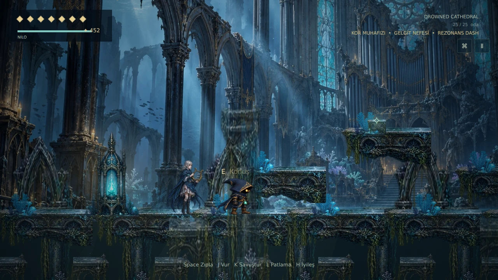
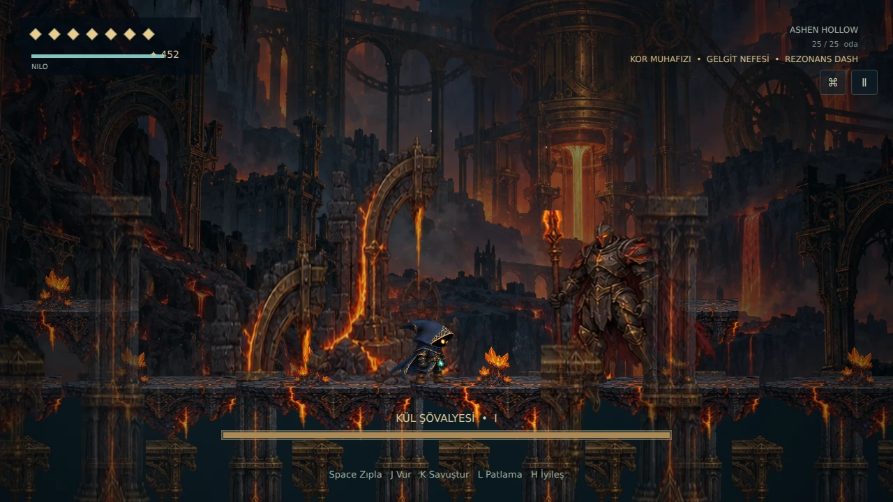

# Echoes of the Forgotten — Three Resonances 0.3

An original browser metroidvania by BRBRS Games. **Playable three-region release: 25 interconnected rooms, three bosses and three traversal rewards. The full seven-region campaign remains in development.**

## Play locally

Node.js 24+:

```sh
npm ci
npm run dev
```

Open the local address shown by Vite. `npm run build` creates the static production site in `dist`. Vercel settings are supplied in `vercel.json` (Vite, build `npm run build`, output `dist`).

## Implemented

- Nine connected Whispering Grove rooms: Lantern Refuge, Whispering Roots, Luminous Canopy, Broken Crossing, Root Archive, Three Chimes Courtyard, Last Vigil, Bellkeeper arena and Memory Threshold.
- Eight Drowned Cathedral rooms: the refuge, stained-glass gallery, underwater archive, three-position sluice, broken organ crossing, choir shrine, Drowned Cantor arena and deep-water route.
- Eight Ashen Hollow rooms: the forge refuge, burned tunnels, three-wheel furnace puzzle, sealed ember vault, moving foundry crossing, watch shrine, Ashbound Knight arena and Three Resonances junction.
- Drowned Cantor: 60 health, three phases, reflected notes, aimed rain, ground waves and telegraphed relocation. Defeat grants Tide Breath: unlimited oxygen and controlled underwater swimming.
- Ashbound Knight: 72 health, three phases, committed spear charge, flame columns, sonic ground waves and punishable parry recovery. Defeat grants Ember Guard: safe hot floors and opened ember seals.
- Four new enemy families (diver, dream leech, ash walker and furnace warden), six poses each; two six-pose bosses. Two independently painted region backgrounds and 60 modular alpha-aligned region atlas entries, including terrain, NPCs and interactive mechanisms.
- Mira’s lost canticle and Wren’s ember quests, six collectible fragments, health/energy upgrades and three functional, mutually exclusive relics: melee damage, damage reduction or reduced resonance costs. Inventory equips them and saves the choice. Regional map tabs show actual discovered rooms; activated shrines allow cross-region fast travel.
- Nilo's 32 painted animation frames, original modular terrain/props, three animated enemy families and four Bellkeeper poses. Separate collision geometry, parallax scenery, lighting, mist, water, particles, camera follow and impact feedback.
- Accelerated/decelerated movement, variable jump, coyote time, jump buffer, wall slide/jump, three-hit combo, up/down attacks, enemy bounce, charged strike, perfect parry, damage invulnerability, energy burst and healing.
- Three-phase, 48-health Bellkeeper fight with melee attacks, ground waves, falling resonance projectiles and punishable recoveries. Defeat unlocks an air/ground dash and the light-barrier traversal route.
- Musical puzzle (I → III → II), health/energy secrets, Elda and Orin conversations, currency, Orin's health upgrade, lore journal and discovered-room map with markers and travel between activated shrines.
- Three versioned local save slots with additive migration of existing v2 Grove saves, checkpoint respawn, corrupt-save validation, settings persistence, menus, adjustable touch controls, keyboard rebinding, standard gamepad mapping and accessibility options.
- Original composed Web Audio score (title, three exploration arrangements, shrine, three boss arrangements and victory, with music fades) and SFX. Audio begins only after interaction.
- PWA manifest, icons and offline caching after an online visit.

## Controls

| Action | Keyboard | Standard gamepad | Touch |
|---|---|---|---|
| Move | A/D or arrows | Stick / D-pad | ‹ / › |
| Jump / wall jump | Space (hold for height) | Bottom face / Cross | ZIPLA |
| Attack / charge | J / hold J | Left face / Square | VUR / hold |
| Up / down strike | W/S + J | D-pad up/down + attack | ↓ + VUR |
| Parry | K | L1 | KORU |
| Dash (after boss) | Shift | Right face / Circle | DASH |
| Echo Burst | L | Top face / Triangle | ✦ |
| Interact | E | R1 | EL |
| Heal | H | L2 | CAN |
| Map / inventory | M / I | Select for map | Top map / pause |
| Pause | Escape | Start / Options | Ⅱ |

Use a lantern to restore health and set a checkpoint. Reloading or continuing starts at that lantern. Saves belong to the browser/device and are not cloud accounts.

## Architecture and validation

TypeScript + Vite; modular Canvas 2D renderer, fixed 120 Hz gameplay simulation, native Web Audio and Gamepad APIs. Source is split into movement, combat/AI, room data, saving, input, audio, rendering and menus. This deliberately small custom engine keeps movement/combat independently testable and the runtime bundle compact.

`npm test` runs deterministic gameplay/save/input tests. `tools/browser-qa.mjs` supplements them with a real Chromium browser, actual input, checkpoint reloads, puzzle gates and a full combat simulations of all three bosses. `docs/QA.md` records results and verification limits. Browser setup is documented in the script; it is not part of the shipped game.

## Scope and limitations

Four remaining regions (Glass Observatory, Mourning City, Dreaming Depths, Silent Throne) and nine further bosses are **planned**. Astral Leap/double jump, Memory Echo, Dream Shift, Harmonic Blade, Refrain Shield, Last Note, light-reflection puzzles and full-campaign endings are absent. No gameplay duration is claimed; expansion is measured by implemented connected content and tested progression.

New game follows Grove → Bellkeeper/Dash → Cathedral → Cantor/Tide Breath → Ashen Hollow → Knight/Ember Guard. Optional underground archives and the ember vault reward backtracking. Previously completed Grove saves continue normally and can reach the cathedral from Memory Threshold’s east exit.

Art consists of generated, aligned painted atlases; some poses change proportions slightly, especially wide sword attacks. The renderer has atmospheric approximations rather than true volumetric lighting or skeletal animation. The score uses synthesized instruments, not recorded orchestral music. Physical iPhone Safari, Android devices and a physical DualSense have not been tested. Mobile layout/pointer behavior and controller mappings can be tested through browser emulation and API fixtures. 60 FPS is a target, not a measured guarantee on physical hardware.

Private playable publication: https://echoes-of-the-forgotten.brbrs0661.chatgpt.site (ChatGPT sign-in required). Sites confirmed successful publication; this browser reached the sign-in gate, so live gameplay is not claimed as tested. Vercel publication still requires project creation permission in BRBRS Games.

## Captures from the running game




See [release validation](docs/QA.md), [asset provenance](docs/ART.md) and [0.3 release notes](docs/RELEASE-0.3.md).
